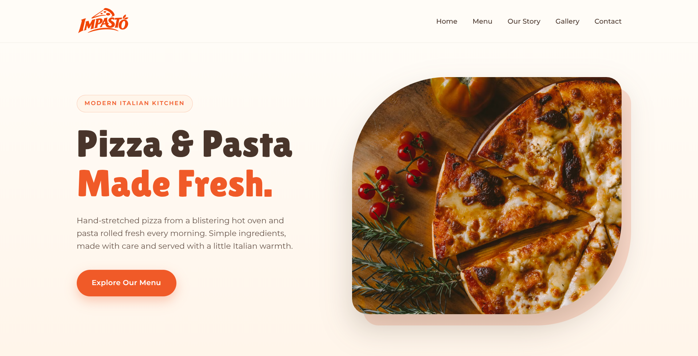

 

  

<h1 align="center">IMPASTO — Italian Restaurant Website</h1>

  <strong>Il vero sapore d'Italia.</strong>
   
Un'esperienza di ristorazione italiana moderna, dove i sapori autentici incontrano un design raffinato.

---

## 📖 About The Project

**Impasto** is a modern restaurant website concept inspired by the rich culinary heritage of Italy, the art of traditional pizza making, and the beauty of Italian dining culture.

Designed with a strong visual identity and a refined aesthetic, Impasto brings the warmth and charm of an Italian restaurant into a seamless digital experience. From its elegant presentation to its carefully crafted interface, every detail is designed to reflect the character, passion, and simplicity of Italian cuisine.

More than just a restaurant website, Impasto represents a digital brand experience built around great food, thoughtful design, and the timeless spirit of Italy.

## ✨ Features

- 🍕 **Italian-Inspired Experience** — A digital presence inspired by authentic Italian cuisine and traditional pizza culture.
- 🎨 **Elegant Visual Identity** — A distinctive design language that reflects the warmth and sophistication of Italian dining.
- 🖥️ **Modern UI/UX** — A clean, visually engaging interface designed to deliver an intuitive browsing experience.
- 📱 **Responsive Layout** — An adaptable design for a consistent experience across desktop, tablet, and mobile devices.
- 🖼️ **Immersive Presentation** — Carefully arranged visuals and content that bring the restaurant's identity to life.
- ⚡ **Smooth Navigation** — A user-focused browsing experience with an emphasis on clarity and usability.

## 🛠️ Tech Stack

- **HTML5** 
- **CSS3**
- **JavaScript**
- **Responsive Web Design**

## 🖥️ Website Preview

  

## 🌐 Live Website

## </> Developer

**Developed by [Raed Mosaed](https://github.comraedmosaed0)**

---

© 2026 IMPASTO. All rights reserved.
